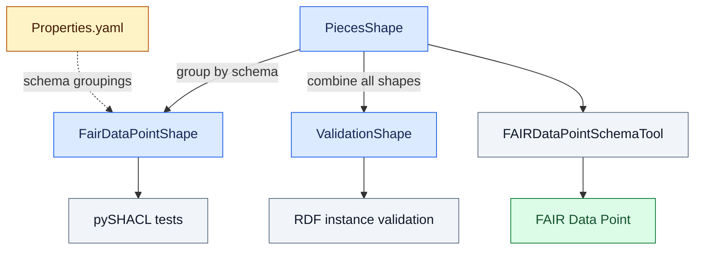

# Health-RI Core Shapes

For v2.1.0, the three SHACL outputs share the **for-FDP specification**. They organize those definitions differently and serve different workflows.

## Which shapes should I use?

| Directory | v2.1.0 layout | Purpose |
|---|---|---|
| [PiecesShape](PiecesShape/) | 19 individual class shape files | Main and supporting class shapes; inputs to `FAIRDataPointSchemaTool` for FDP publication and to the combined outputs. |
| [FairDataPointShape](FairDataPointShape/) | 7 schema bundles | Each configured schema together with its required supporting shapes, prepared for FDP use. Selected bundles are also used by the automated tests. |
| [ValidationShape](ValidationShape/) | 1 combined shape file | All individual shapes in one graph for RDF instance validation. It retains the same FDP-oriented basis. |

These folders represent different packaging of the FDP-oriented definitions. A separate set of model-oriented shapes is a design question that the team deferred to a major release.

## Packaging and consumers

The diagram shows the shape groupings and their consumers. It omits spreadsheet conversion commands and manual editing steps, which require confirmation from the generation maintainers.

Colors identify roles: **blue** for SHACL outputs, **amber** for configuration, **gray** for tools and validation activities, and **green** for the FDP service.

Maintainers clarified during v2.1.0 release testing that `FAIRDataPointSchemaTool` receives the individual files from `PiecesShape` when publishing schemas to an FDP. In earlier model versions, that tool also assembled the combined files. The current generation pipeline produces all three outputs.

[Properties.yaml](Properties.yaml) lists the source pieces for each schema, the schemas to publish, FDP resource relationships, the schema version, and input/output locations. Its v2.1.0 `inputDir` points to the upstream `testing` branch.

See [SHACL_pipeline_templates](SHACL_pipeline_templates/) for the intermediate Excel templates and [Documents](../../Documents/README.md) for the model and FDP workbooks.

## FDP adaptations and release notes

The release-testing discussion identifies a mandatory `dct:title` requirement for classes managed as independent FDP resources. A check that a title property exists does not establish that it is mandatory. In the current v2.1.0 [Distribution piece](PiecesShape/hrishapes-distribution.ttl) and [Distribution bundle](FairDataPointShape/Distribution.ttl), the title property has no `sh:minCount`. This records the title-cardinality concern raised during release testing.

The common FDP-oriented basis does not by itself establish exact constraint parity between every checked-in output. Consult the relevant shapes when checking a particular constraint.

For a separate example of validation-message design, [HealthDCAT-AP issue #65](https://code.europa.eu/healthdataeu/healthdcat-ap/-/work_items/65) discusses separating cardinality and nested-shape checks to avoid misleading messages. That report does not establish the same defect in Health-RI.
