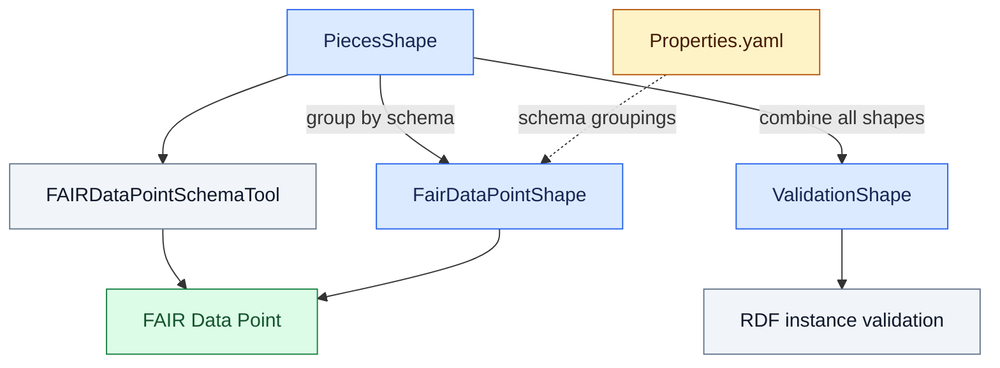

# Health-RI Core Shapes

The core SHACL shapes for v2.1.0 are available in three layouts based on the **for-FDP specification**. Each layout serves a different FDP publication or RDF instance validation workflow.

## Which shapes should I use?

| Directory | v2.1.0 layout | Purpose |
|---|---|---|
| [PiecesShape](PiecesShape/) | 19 individual class shape files | Main and supporting class shapes used to build the combined outputs and as input to `FAIRDataPointSchemaTool`. |
| [FairDataPointShape](FairDataPointShape/) | 7 schema bundles | Schema-specific groupings of the individual shapes, configured in `Properties.yaml` and prepared for FDP use. |
| [ValidationShape](ValidationShape/) | 1 combined shape file | All individual shapes in a single graph for RDF instance validation. |

## Packaging and consumers

The individual shapes in `PiecesShape` are grouped by schema into `FairDataPointShape` bundles, using the groupings defined in `Properties.yaml`, or combined into `ValidationShape` for RDF instance validation. `FAIRDataPointSchemaTool` consumes the individual pieces for schema publication to a FAIR Data Point. The `FairDataPointShape` bundles provide another path for supplying shapes to a FAIR Data Point.

In the diagram, solid arrows show shape aggregation or use, while the dashed arrow identifies configuration. Colors distinguish **SHACL artifacts** (blue), **configuration** (amber), **tools and validation activities** (gray), and the **FAIR Data Point service** (green).

[Properties.yaml](Properties.yaml) defines the pieces included in each schema bundle, the schemas to publish, FDP resource relationships, the schema version, and the input/output locations. For v2.1.0, its `inputDir` references the upstream `testing` branch.

See [SHACL_pipeline_templates](SHACL_pipeline_templates/) for the intermediate Excel templates and [Documents](../../Documents/README.md) for the model and FDP workbooks.

## Validation considerations

All three SHACL layouts are based on the FDP-oriented specification, not directly on the reference metadata workbook. They therefore retain FDP-specific validation adaptations, including the relaxed minimum cardinality of `dcat:dataset` for catalogues and the additional mandatory `dct:title` constraint for distributions.

In particular, the combined `ValidationShape` graph should not be interpreted as an independent implementation of the reference specification.

See [FDP-specific validation rules](../../Documents/README.md#fdp-specific-validation-rules) for the precise differences and their rationale. Inspect the actual SHACL revision used by your workflow to determine which constraints are enforced.
